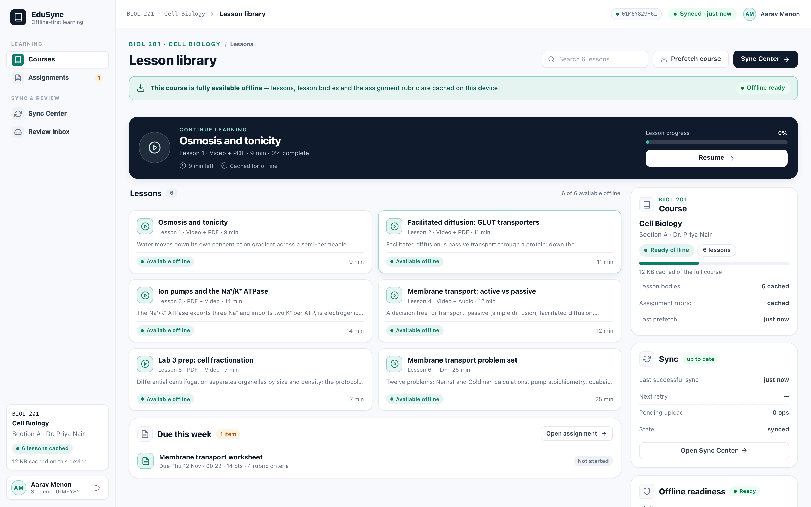
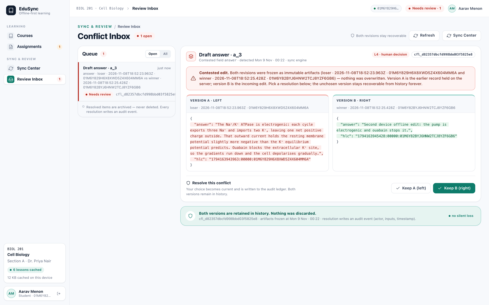
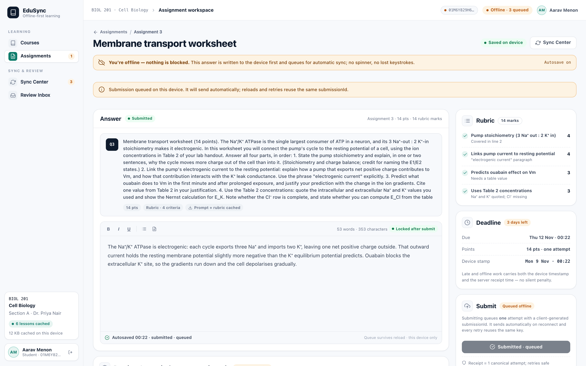
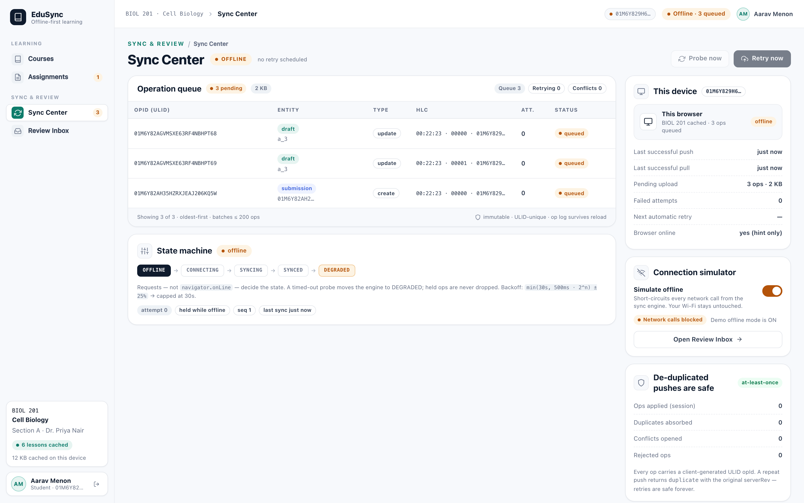
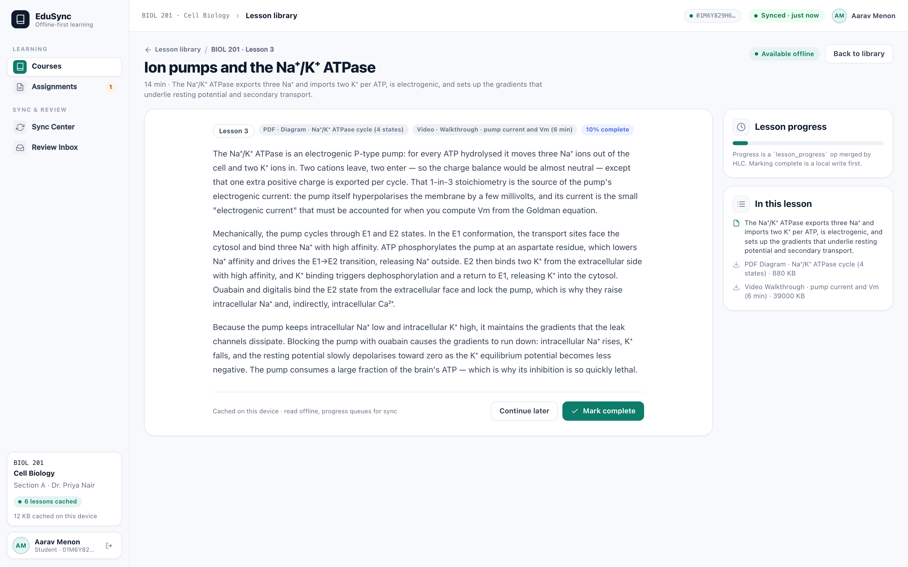

# Running EduSync

**Status: Phase 2 Complete (CRDT Collaborative Documents).** Both the local-first record-sync spine (drafts, submissions with exactly-once idempotency) and Yjs collaborative documents (`d_group2` shared lab notes with WebSocket live presence and offline commutative merge) are implemented and verified end to end.

The design pack (problem, solution, architecture, mockups) is in [`README.md`](README.md) and [`SPEC.md`](SPEC.md); the API contract is in [`docs/CONTRACT.md`](docs/CONTRACT.md).



---

## Quickstart

```bash
npm install          # once, workspace root
npm run dev          # Fastify API on :8787 + Vite app on :5173
```

Open <http://127.0.0.1:5173/?as=u_aarav&page=library>.

| URL | What it shows |
|---|---|
| `/?as=u_aarav&page=library` | student library, offline-ready chips, lesson reader |
| `/?as=u_aarav&page=assignment` | autosaving assignment + exactly-once submit |
| `/?as=u_aarav&page=doc` | collaborative shared document (`d_group2`) with Yjs CRDT + presence |
| `/?as=u_aarav&page=sync` | Sync Center: durable queue, HLC per op, attempts, backoff, connection simulator |
| `/?as=u_aarav&page=review` | Review Inbox: two-pane conflict diff, resolve mine/theirs |
| `/?page=login` | seeded users: Aarav (student), Yuki (student), Dr. Priya (instructor) |

Dev flags: `?as=<userId>` auto-login, `?page=library|assignment|doc|sync|review|login`, `?offline=1` boot offline, `?fresh=1` wipe the local IndexedDB (useful for demos).

One-command acceptance run:

```bash
npm run verify       # types + unit tests + HTTP e2e + web build + real-browser UI run on a fresh DB
npm run ui           # just the Playwright UI acceptance (stack must be running)
npm run e2e          # just the HTTP/protocol acceptance (spawns its own server + temp DB)
```

Reset the demo data: `rm -rf apps/server/data && npm run dev` (schema + seed are recreated on boot).

---

## Demo script (5 minutes)

1. **Online load** — library shows "Available offline" chips; the course is prefetched into IndexedDB.
2. **Go offline** — Sync Center → *Connection simulator* switch on. Status pill flips to amber `Offline · N queued`.
3. **Write and submit** — open the assignment, type an answer (locally autosaved, `N ops queued`), press *Submit assignment*. The receipt appears immediately: `1 canonical attempt; retries safe`.
4. **Kill it** — reload the page. The answer and the queued submission survive (durable op log in IndexedDB).
5. **Reconnect** — switch the simulator off, press *Retry now*. The queue drains (`Syncing i/n → Synced`). Open Sync Center: ops show `applied`.
6. **Prove exactly-once** — `curl /api/submissions/mine` with a fresh login for `u_aarav`: **one** submission, even though the client retried.
7. **The twist** — push a competing draft from a second device (see below), then open **Review Inbox**: both versions are frozen side by side, nothing was discarded, and choosing *Keep B (right)* records the decision in the audit ledger.

Reproduce step 7 from the shell:

```bash
TOKEN=$(curl -s -X POST localhost:8787/api/auth/login -H 'content-type: application/json' \
  -d '{"userId":"u_aarav","deviceId":"dev_second","platform":"curl"}' | python3 -c 'import sys,json;print(json.load(sys.stdin)["token"])')
curl -s -X POST localhost:8787/api/sync/push -H "authorization: Bearer $TOKEN" -H 'content-type: application/json' \
  -d '{"ops":[{"opId":"01J9Z6K3Q8R2V7M4X1N5B0T6ZZ","deviceId":"dev_second","hlc":"1794163800000:00001:dev_second","entity":"draft","entityId":"a_3","type":"update","baseRev":1,"payload":{"assignmentId":"a_3","answer":"a competing offline edit","answerHlc":"1794163800000:00001:dev_second","baseAnswerHlc":null}}]}'
```

The response reports `status: "conflict"`; `GET /api/conflicts` has both versions; the Review Inbox shows them.



---

## What is implemented

### Server (`apps/server`)

- **Node 26 + Fastify 5 + `node:sqlite`** (no native deps, no Docker needed). WAL, foreign keys, idempotent schema + seed.
- **Op-log sync engine**: `POST /api/sync/push` dedupes by ULID `op_id` (unique index), sorts each batch by HLC per entity, applies the merge ladder, and returns `applied | duplicate | conflict | rejected` with the server revision. Replays are safe by construction.
- **Draft merge ladder**: L0 identical → L2 HLC ordering → **L4 contested**: the HLC winner is applied *and* a `conflicts` row keeps the losing version (left) and winner (right) forever. No silent loss.
- **Exactly-once submissions**: client-generated `submissionId`; `UNIQUE(submission_id)` makes retries return the same attempt (`deduped: true`); a *different* submission id for the same assignment returns `409 already_submitted` + a conflict. Attempt numbers are unique.
- **Delta pull** by per-user monotonic `seq` cursor, plus `GET /api/sync/state-hash` (sha256 of canonical records + conflict ledger) for convergence checks.
- **Audit ledger** (hash-chained events), devices, seeded catalog (6 lessons, 14-point assignment with rubric).
- 31 unit/route tests (`node:test`, temp DB per test).

### Web client (`apps/web`)

- **React 18 + Vite + TypeScript**, IndexedDB (`idb`) with stores for `meta`, `ops`, `records`, `conflicts`, `catalog`.
- **Durable sync engine** (`src/sync/engine.ts`): enqueue → persist → flush; batches oldest-first; state machine `offline | connecting | syncing | synced | degraded`; jittered exponential backoff `min(30s, 500ms·2ⁿ) ±25%`; never drops un-acked ops; rejected ops are terminal (they cannot poison the queue).
- **Pages**: Login, Library (prefetch, offline chips, lesson reader), Assignment (debounced autosave, always-visible status line, one-time submission id, receipt + confirmed attempt), Sync Center (per-op table with opId/entity/HLC/attempts/status, device list, connection simulator, Retry now), Review Inbox (two-pane JSON diff, honest "Version A/B" labels, resolve via server).
- **Offline-safe boot**: server unreachable → app boots from IndexedDB, shows `Degraded` and keeps working.
- Design tokens copied from the design pack; matches the mockups.

### Protocol package (`packages/protocol`)

- ULIDs (monotonic), Hybrid Logical Clock (fixed-width, lexicographic = causal order), canonical JSON, the merge ladder (`mergeField`), and all wire types shared by both sides. 5 unit tests.

---

## Verification evidence

`npm run verify` on a clean checkout (all steps green):

| Check | Command | Result |
|---|---|---|
| Types | `npm run typecheck` | clean (strict TS, 3 packages) |
| Protocol unit tests | `npm test` | **5/5** |
| Server unit + route tests | `npm test` | **31/31** |
| HTTP/protocol acceptance | `npm run e2e` | **39/39** checks |
| Production build | `npm run build` | 58 modules, 239.55 kB JS / 34.92 kB CSS |
| Real-browser UI acceptance | `npm run ui` | **22/22** checks |

The HTTP harness (`scripts/e2e-smoke.mjs`) boots the real server on a throwaway DB and proves: duplicate op replay doesn't move the state hash or change feed; out-of-order batches converge on the HLC winner; a stale concurrent draft opens a conflict with both versions retained; 5 submissions with one id produce 1 attempt + 4 duplicates; a different id is rejected with `409`; pull cursors page correctly; **two independent servers fed the same op set in different delivery orders produce an identical state hash**.

The UI harness (`scripts/ui-verify.mjs`, Playwright) drives the actual app: login → offline-ready library → lesson reader → go offline → type + submit → **reload** (queue survives) → reconnect → queue drains → server holds exactly one submission → second-device edit opens the Review Inbox → resolve it in the UI → server ledger records the resolution, with zero uncaught page errors.

Screenshots from the UI run are in [`docs/shots/`](docs/shots/) and `artifacts/ui/`.

| | |
|---|---|
|  |  |
|  |  |

---

## Architecture of the code

```
packages/protocol/        shared wire types + ULID + HLC + merge ladder + canonical JSON
apps/server/
  src/db.ts               node:sqlite schema (idempotent) + WAL + transactions
  src/seed.ts             exact hackathon seed data
  src/auth.ts             dev bearer token (userId + deviceId)
  src/sync.ts             applyOp / pullChanges / stateHash / submitOnce / resolveConflict
  src/store.ts            per-user change feed, deterministic conflict ids, audit chain
  src/routes/*            health, auth, catalog, submissions, sync, conflicts
  src/app.ts              buildApp({ dbPath }) — injectable for tests
apps/web/
  src/db.ts               IndexedDB (meta, ops, records, conflicts, catalog)
  src/sync/engine.ts      durable op queue + push/pull loop + state machine
  src/auth.ts             local-first session, ULID device id
  src/pages/*             Library, Assignment, SyncCenter, ReviewInbox, Login
scripts/
  e2e-smoke.mjs           HTTP acceptance (spawns its own server + temp DB)
  ui-verify.mjs           Playwright UI acceptance + screenshots
  verify.sh               everything, on a fresh DB
  demo.sh                 start/stop the demo stack
```

### Invariants the code enforces

1. **No un-acked op is ever dropped** — the queue is IndexedDB-backed and only removes ops after `applied`/`duplicate`; the UI says `Degraded` rather than pretending.
2. **An edit is applied at most once** — `UNIQUE(op_id)` on the server; replay returns the original revision.
3. **A submission exists at most once** — `UNIQUE(submission_id)`; retries are idempotent, a different submission is a conflict, not a second attempt.
4. **Concurrent different values are never silently discarded** — L4 freezes both, records them in `conflicts` + the audit chain, and surfaces them for a human decision.
5. **Clients converge** — same op set in any delivery order yields the same state hash.

---

## Known limitations (honest)

- **Documents are CRDTs (Phase 2 Complete):** Shared document `d_group2` co-editing uses Yjs CRDTs with offline local snapshot persistence, cursor-based delta pull, WebSocket live presence, and mathematically proven cross-order convergence (verified in `apps/server/test/docs-sync.test.ts`).
- **One attempt per assignment** (MVP policy). Restricting/no-resubmission policy is hard-coded server-side; production needs a policy table.
- **Exam integrity not built yet** — sealed packages, monotonic timer and hash-chained answer log are designed (see SPEC §2.7) but not implemented.
- **Dev-grade auth** (unsigned base64 token) and **SQLite single-node** — fine for a hackathon demo, not production.
- **Service worker installed** — PWA app shell and offline asset caching enabled.
- **Conflict resolution is manual** by design; a policy engine (instructor wins, etc.) is a follow-on.

## What's next

1. **Policy Engine for Conflict Resolution** — automatic rule-based resolution (e.g. instructor overrides student) when manual review isn't needed.
2. **Exam mode** — sealed signed package, monotonic timer anchored to a signed start, hash-chained answer log, server verification that flags (never auto-fails) for human review.
3. **Service worker** — app-shell offline boot; prefetch media.
4. **Instructor view** — class sync health, attempt counts, integrity flags in the human-review queue.
5. Production hardening — Postgres + Redis via docker-compose, real auth, metrics (OpenTelemetry), chaos tests.
